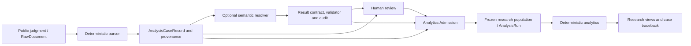
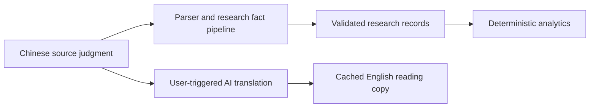
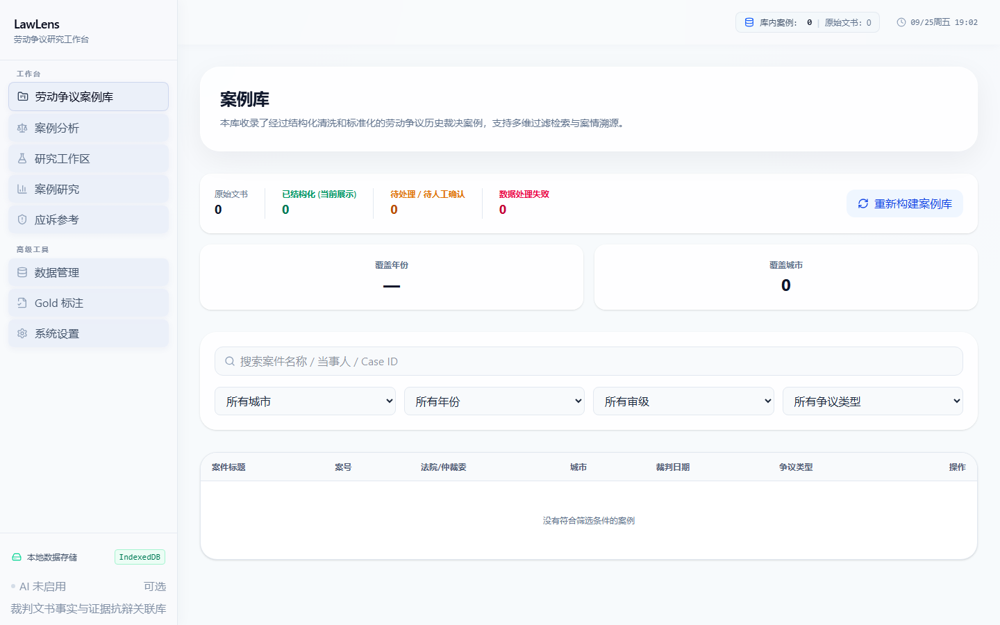
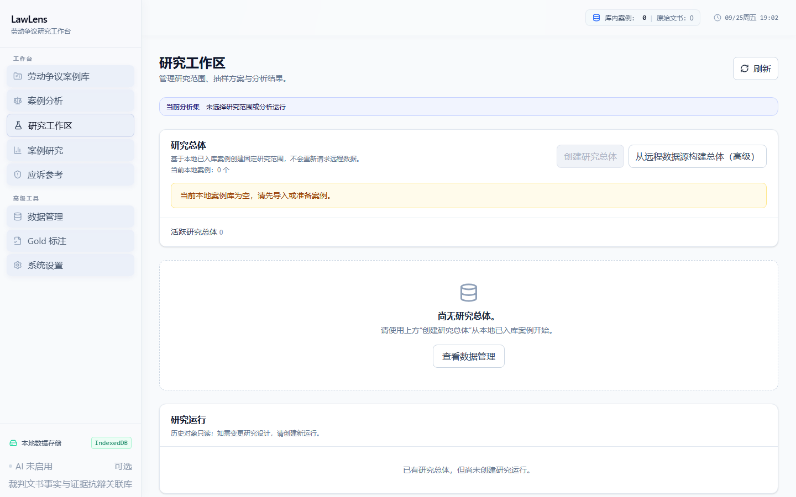
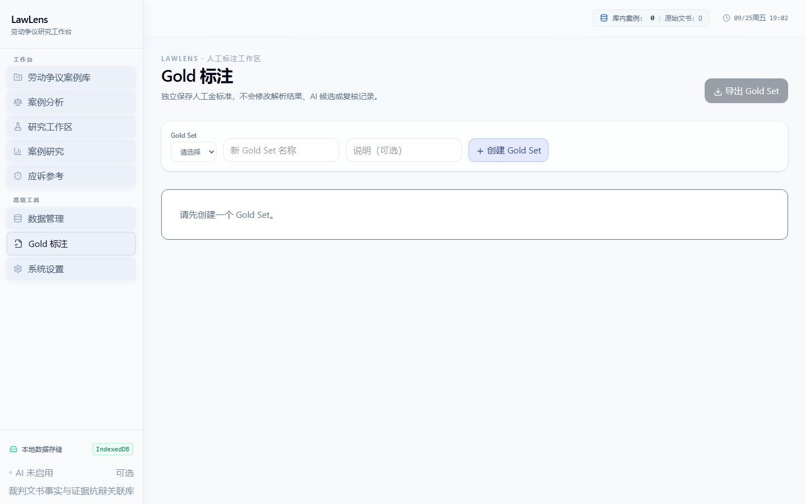

# LawLens

**A trustworthy AI-assisted legal analytics system for labor-dispute judgments.**

LawLens turns public judgments into structured, reviewable research records. Rules extract what can be identified reliably; a third-party language model proposes answers to harder semantic questions; contracts, validators, and human review control what enters research. Statistics are calculated by deterministic code.

🌐 **Live Demo:** [Open LawLens](https://lyzerh.github.io/Analysis-of-Labor-Disputes/) · [Project brief](docs/project-brief.md) · [Representative cases](docs/representative-cases.md)

The hosted interface can be explored without an API key. Model-assisted features require a user-provided xAI key. Browser data is local, so a fresh visit may show an empty case library until documents are imported.

## Why LawLens?

Judgments contain valuable evidence about labor disputes, but their free-form language is difficult to study systematically. A single document can mix an employee's claim, an employer's defense, a counterclaim, an appeal, judicial reasoning, and the final disposition. Treating those passages as interchangeable produces misleading data. Research also needs a defined case population and a way to trace each result back to its source.

LawLens aims to preserve those distinctions while supporting empirical analysis. It is **not** a legal-advice service, outcome predictor, or automated adjudicator.

## Project goals

- Structure public labor-dispute judgments while preserving source provenance and party/claim identity.
- Use deterministic extraction and model-assisted semantic candidates where appropriate.
- Expose uncertainty and technical failures for human review rather than silently counting them.
- Freeze research populations and analysis runs so statistics can be reproduced and traced to cases.
- Provide a Chinese/English research interface without changing stored business values.

## System architecture



Parsing creates the initial `AnalysisCaseRecord`; semantic resolution does not create the case. A model output is a candidate, not a research fact. Admission may block unclear or conflicting records. Human-reviewed outcomes also pass the same admission rules. The frozen analysis set determines which cases the statistics use.

Optional translation follows a separate reading path:



The Chinese source remains authoritative. The English reading copy is presentation-only and is not an input to parsing, Gold annotation, Benchmark evaluation, or analytics.

## Trustworthy AI design

**AI proposes. Rules validate. Humans review. Deterministic programs calculate.**

- **Rule-first, model-assisted:** the parser identifies structured fields and request provenance; the semantic resolver addresses harder claim/outcome relationships.
- **Validation before statistics:** schema, identity, evidence and relationship checks are separate from model generation. `AnalyticsAdmission` decides whether a record can contribute to analysis.
- **Human authority with a safety gate:** reviewers can confirm a claim outcome, including when an AI call fails, but an unclear result remains blocked from analytics.
- **Traceability:** raw documents, claim provenance, candidate output, review decisions and frozen analysis inputs are kept distinguishable.
- **Failure visibility:** technical provider failures are recorded separately from semantic uncertainty.
- **Translation isolation:** optional AI translation assists reading and never changes the underlying research facts.

## Evaluation

These are **small, differently scoped evaluations**, not a general accuracy estimate. The rules-only sample concerns already extracted, manually annotated substantive claim records. The semantic benchmark concerns identity-verified Gold claims. Their denominators cannot be compared as an improvement percentage.

| Evaluation | Sample | Observed result | What it means |
| --- | --- | --- | --- |
| Rules-only extraction classification | 26 extracted, annotated substantive claim records | 12 correct; 4 wrong type; 10 spurious | `12/26 = 46.2%` correct **among these extracted records**. Missed claims and recall were not measured. |
| Model-call execution | 8 eligible Gold claims | 8/8 calls succeeded | Execution success, not semantic accuracy. |
| Definite semantic candidate coverage | Same 8 claims | 5/8 definite; 3/8 unresolved / sent to human review | Coverage of this frozen, identity-verified benchmark sample. |
| Agreement on definite candidates | 5 definite candidates | 5/5 matched the human Gold labels | Agreement **only on the definite subset**, not overall accuracy. |

The Gold Set contained 10 cases; only eight claims met the benchmark's substantive, determinate and identity-verification criteria. See [limitations](docs/limitations.md) and [case studies](docs/representative-cases.md) for boundaries and difficult examples. Historical experimental runs are documented separately in [the experiment archive](docs/experiments/semantic-resolution-2026-09.md); their figures are not pooled with the eight-claim benchmark.

## Representative cases

The [case studies](docs/representative-cases.md) use anonymized descriptions of public judgments to show procedural-role complexity, a claim-identity mismatch across historical and reconstructed records, and an appeal that correctly remained unresolved. They explain what is confirmed by a source document, an archived experiment, or current-code reconstruction; these are different forms of evidence.

## Research interface

LawLens supports Case Research, Defense Insights, Human Review, Gold annotation and a small Benchmark workflow. Research populations and `AnalysisRun` snapshots define the analyzed cases; the case library can contain other documents without adding them to a particular result.

The UI supports `zh-CN` and English. Known taxonomy values receive display-only labels, while the stored values and statistical keys stay unchanged. Unknown taxonomy values fall back to their source labels. Original Chinese judgments remain accessible even when a user requests an English reading copy.

## Screenshots

These repository screenshots are **interface examples**, not evidence of an evaluation result. The case-library capture shows an empty local library.

| Case library | Research workspace | Gold Benchmark |
| --- | --- | --- |
|  |  |  |

## Technology and reproducibility

React, TypeScript, Vite and Tailwind CSS power the interface; IndexedDB/Dexie stores browser-local records; Recharts renders charts. The current formal browser semantic path uses xAI through a bring-your-own-key (BYOK) configuration. Vitest and `fake-indexeddb` cover contracts and storage upgrades. Legacy provider adapters remain in the repository but are not the main hosted-demo path.

Use Node.js 22 and npm:

```bash
npm ci
npm run dev
```

Open `http://localhost:3000/`. Model-assisted features need a user-configured key; deterministic and local review paths do not. Verify with:

```bash
npm test
npm run lint
npm run build
npm run build:pages
```

At the bilingual/translation milestone, the recorded automated run passed **65 test files / 881 tests**, lint and production build. This is an engineering regression result, not a legal-outcome accuracy claim. See the commands above for a fresh run on the current checkout.

## Limitations and responsible use

Published judgments are a selected subset of labor disputes; publication practices and regional language vary. The claim taxonomy and rules may miss new expressions. Model candidates can be wrong, and the present Gold benchmark is too small for population-level accuracy or cross-region generalization. Analytics describe the included historical documents; they do not predict a future case or establish causation. See the [detailed limitations](docs/limitations.md).

Public judgments may still contain personal information. Avoid unnecessary redistribution of identifiable source text. Review provenance and provider terms before submitting document excerpts to third-party AI. The BYOK key is configured for the browser session and is not part of a research dataset; do not place credentials in source control. Optional translation is user-triggered, may contain errors, and is not an official legal translation. Neither model output nor statistics determine anyone's legal rights.

## Project highlights and next steps

- Built a rule-first legal data pipeline with a constrained semantic-candidate path.
- Separated technical failure, semantic uncertainty and reviewed outcomes.
- Made research statistics depend on admission rules and frozen analysis inputs.
- Added Gold identity verification and a benchmark with explicit eligible denominators.
- Localized presentation without changing canonical data or analytics keys.
- Isolated optional translation from the research fact chain and tested a Dexie storage upgrade.

Next work would expand the Gold Set, test across regions and sources, improve claim/disposition alignment and evidence taxonomy, and evaluate translation quality. These are open research tasks, not existing performance claims.

## Scope and license

LawLens is an educational legal-analytics research project. It does not provide individualized legal advice. No repository license is specified at present; third-party resources retain their own terms.
